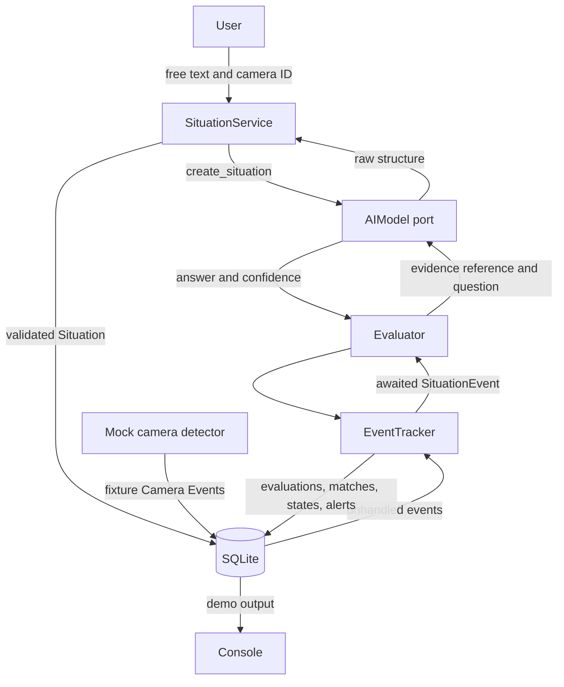
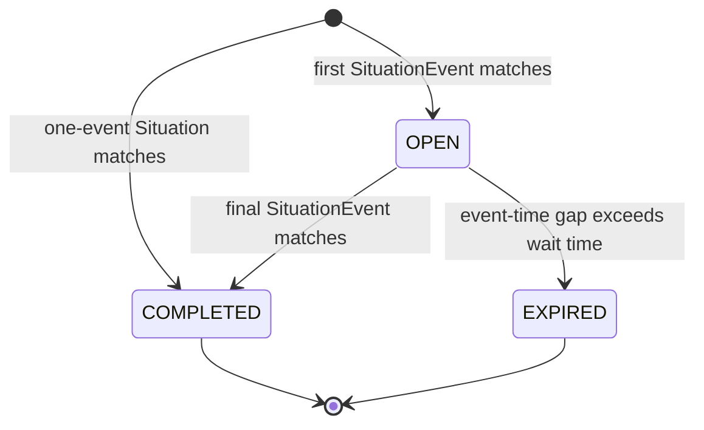
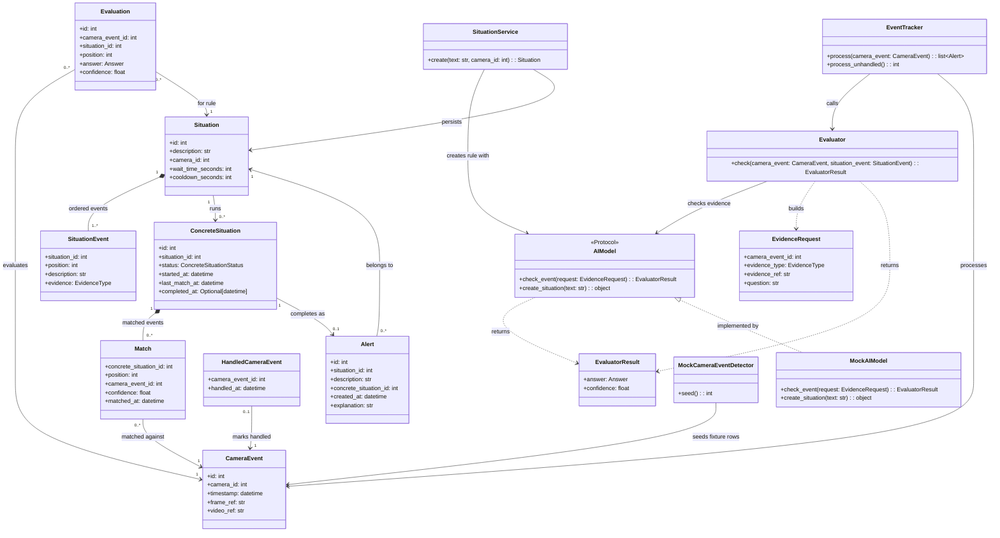
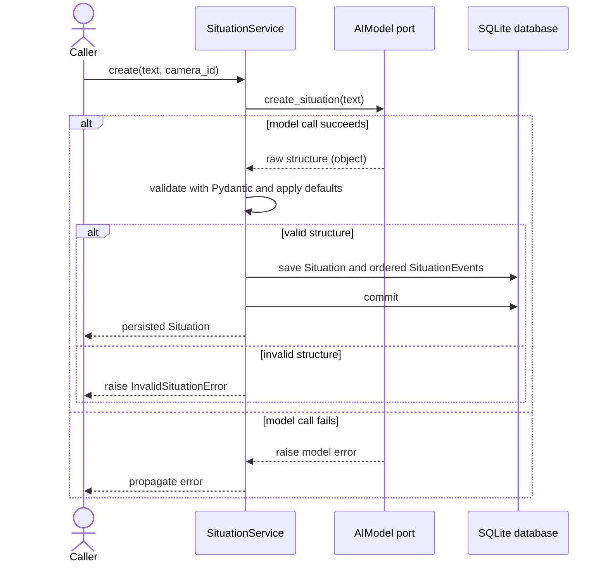
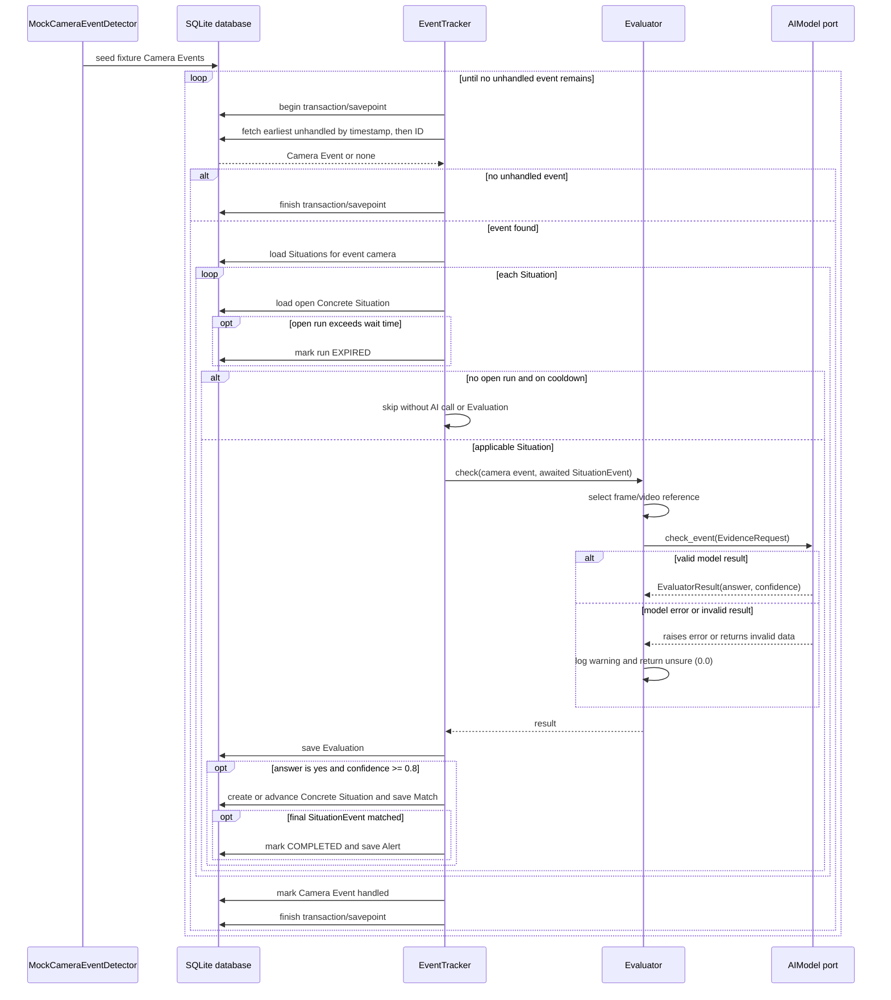

# CCTV Event Analytics

## Project layout

```text
app/
  adapters/       Fixture-backed model and camera-event detector
  db/             SQLAlchemy tables, repositories, and session helpers
  domain/         Pydantic models, validation, and time handling
  ports/          AIModel interface
  services/       Situation creation, evaluation, and event tracking
  demo.py         Runnable end-to-end fixture demo
fixtures/         Camera events and mock AI responses
tests/            Unit and integration tests
```

## Run the project

### With Docker

Build the image and run all six demo scenarios:

```powershell
docker build -t cctv-analytics .
docker run --rm cctv-analytics
```

Run the test suite in the image:

```powershell
docker run --rm cctv-analytics pytest
```

### Locally

Use Python 3.12 or newer. From the repository root, create and activate a
virtual environment in PowerShell, install the project, then run the demo or
tests:

```powershell
python -m venv .venv
.\.venv\Scripts\Activate.ps1
python -m pip install -e ".[test]"
python -m app.demo
python -m pytest -q
```

If `python` is not on `PATH`, use the full path to your Python 3.12 executable
to create the virtual environment.

## Terminology

| Term | Meaning |
|---|---|
| **Camera Event** | An externally supplied record with an ID, camera ID, timestamp, and references to a frame and video. Its ID is only an identifier; it does not describe the event. |
| **Event** | One ordered condition within a Situation, with a description and required evidence (`frame` or `video`). In the code and database this is named `SituationEvent` to distinguish it from a Camera Event. |
| **Situation** | A user's rule for one camera: an ordered list of Situation Events, a wait time, and a cooldown. |
| **Concrete Situation** | One run of a Situation, with its matched events and status: `OPEN`, `COMPLETED`, or `EXPIRED`. |
| **Match** | A record that a Situation Event matched a particular Camera Event, including confidence and timestamp. |
| **Evaluation** | The `yes`, `no`, or `unsure` answer and confidence for one Situation Event checked against one Camera Event. |
| **Alert** | A database record created when a Concrete Situation matches its final Situation Event. The demo prints it; no external notification is sent. |
| **AIModel** | A port with `check_event` and `create_situation` operations. Only the fixture-backed mock is implemented. |
| **Evaluator** | Selects the referenced frame or video and asks the AIModel to check one Situation Event against one Camera Event. |
| **EventTracker** | Applies expiry, cooldown, evaluation, matching, state transitions, and alert creation. |
| **SituationService** | Gets a raw Situation structure from the AIModel, validates it, applies defaults, and persists the Situation. |

## Architecture overview



The application has two main flows:

1. **Create a rule:** the SituationService asks the AIModel for a raw structure,
   validates it with Pydantic, applies defaults and limits, and saves the
   Situation and its ordered Situation Events. A valid Situation is active
   immediately; there is no confirmation step.
2. **Process events:** the EventTracker processes Camera Events, checks the
   currently awaited Situation Event for each applicable Situation on that
   camera, and persists the resulting evaluations and state changes.

The `AIModel` is an interface boundary, not a claim that two implementations
already exist. The mock is implemented; a real Qwen adapter is future work.

## Components and validation

### Camera Event detector

The external camera system owns Camera Event creation. The demo's
`MockCameraEventDetector` reads prepared records from
[`fixtures/camera_events.yaml`](./fixtures/camera_events.yaml) and inserts them
into the database.

### AI model port and mock

The `AIModel` protocol defines two operations:

- `check_event(request)` accepts an `EvidenceRequest` containing a Camera Event
  ID, evidence type, evidence reference, and question. It returns an
  `EvaluatorResult` with an answer (`yes`, `no`, or `unsure`) and confidence
  from 0 to 1.
- `create_situation(text)` returns a raw, untrusted Python object. The
  SituationService validates it before saving anything.

`MockAIModel` uses YAML fixtures. It does not open or inspect image or video
content. The Evaluator logs model errors and returns `unsure` with confidence
`0.0` if an evaluation call fails or returns invalid data.

### Situation creation and validation

Each Situation must contain at least one Situation Event. Each event needs a
non-empty description and evidence type `frame` or `video`. Extra fields are
rejected.

| Setting | Default | Accepted range |
|---|---:|---:|
| Wait time | 300 seconds | 20-600 seconds |
| Cooldown for a one-event Situation | 300 seconds | 0-1800 seconds |
| Cooldown for a multi-event Situation | 0 seconds | 0-1800 seconds |

An explicitly supplied cooldown is validated against the same range. Invalid
AI-generated structures are rejected before persistence.

### Persistence and transactions

SQLAlchemy repositories encapsulate database queries and entity additions.
Services and the EventTracker also use the injected SQLAlchemy session for
transaction ownership and flushing. The EventTracker scopes each Camera Event
to a transaction, using a nested savepoint when the caller already has an
active transaction; it does not commit a caller-owned outer transaction.

## Data model

SQLite stores the application's state. All mapped database datetime values are
read as timezone-aware UTC.

| Table | Purpose |
|---|---|
| `camera_events` | Camera-system event records; treated as read-only by the application. |
| `handled_camera_events` | Marks Camera Events that finished processing. |
| `situations` | User rules, including camera, wait time, and cooldown. |
| `situation_events` | Ordered descriptions and evidence requirements for a Situation. |
| `concrete_situations` | Individual runs and their lifecycle states. |
| `matches` | Situation Events matched to Camera Events, with confidence and timestamp. |
| `evaluations` | Persisted `yes`, `no`, and `unsure` answers with confidence. |
| `alerts` | Completed Situation result and code-generated explanation. |

Database constraints protect important invariants:

- At most one `OPEN` Concrete Situation exists per Situation.
- A Camera Event cannot be matched twice in the same Concrete Situation.
- A Concrete Situation can produce at most one Alert.
- A Camera Event/Situation pair can have at most one Evaluation.

Cooldown is not stored as a separate state field. It is calculated from the
latest completed Concrete Situation's `completed_at` timestamp and the
Situation's `cooldown_seconds`.

## Event processing

For each Camera Event processed by `process_unhandled()`:

1. Select the earliest unhandled event by timestamp, then ID.
2. Load Situations assigned to that Camera Event's camera.
3. For each Situation, load its open Concrete Situation, if one exists.
4. If the time since its last matched event is greater than the wait time, mark
   it `EXPIRED`. The current Camera Event may then be checked against the first
   Situation Event as a new run.
5. If there is no open run and the Situation is on cooldown, skip it entirely:
   no Evaluation, model call, or new Concrete Situation is created.
6. Otherwise, check the awaited Situation Event: position 0 for a new run, or
   the next unmatched position for an open run. Persist the Evaluation.
7. Advance only when the answer is `yes` and confidence is at least `0.8`.
   `no`, `unsure`, and lower-confidence `yes` results do not advance.
8. A single Camera Event advances a Concrete Situation by at most one
   Situation Event. When the final event matches, mark the run `COMPLETED` and
   save an Alert with a code-generated explanation.
9. Mark the Camera Event handled after its Situations have been processed.

The wait time applies to each gap between successive matches; the clock starts
again at the timestamp of each match. Expiry is lazy: an overdue run is marked
`EXPIRED` only when a later Camera Event for that camera is processed.
Completed and expired Concrete Situations are retained.

The `process_unhandled()` batch path preserves timestamp/ID ordering by fetching
one event at a time. Calling `process(camera_event)` directly is useful when a
caller intentionally chooses the event; it does not itself enforce batch
ordering.

### Concrete Situation states



Wait time is measured between matches using Camera Event timestamps. After each
match, the gap timer starts again. Expiry is lazy: an overdue `OPEN` run changes
to `EXPIRED` when the next Camera Event for that camera is processed. A
one-event Situation moves directly from the initial state to `COMPLETED`.

## Mock strategy and tests

The mocks replace perception with deterministic fixture results. This makes the
business rules reproducible and testable without claiming to measure real model
accuracy.

- `MockCameraEventDetector` seeds prepared Camera Events.
- `MockAIModel.check_event` looks up an answer by Camera Event ID and question
  in [`fixtures/ai_check_answers.yaml`](./fixtures/ai_check_answers.yaml).
- `MockAIModel.create_situation` looks up a prepared structure by free-text
  input in [`fixtures/ai_situations.yaml`](./fixtures/ai_situations.yaml).
- Tests cover missing or malformed fixture data, invalid Situation structures,
  and model failures.
- Tests cover validation, persistence constraints, adapters, evaluation,
  expiry, cooldown, confidence thresholds, transaction behavior, and integrated
  demo scenarios.

These tests verify application behavior against scripted answers. They do not
measure how accurately a real vision-language model detects events; that would
require a labelled evaluation dataset.

## Demo scenarios

The demo creates one Situation for each of six cameras, seeds fixture events,
processes them, and prints processing outcomes, Alerts, and Concrete
Situations. Scenario F is included in the demo; it is not optional.

| Scenario | What the fixtures exercise | Expected outcome |
|---|---|---|
| **A. Single-event smoke rule** | Event 101 matches the frame-based smoke condition; event 102 arrives during the 300-second cooldown. | One Alert at event 101. Event 102 is skipped without an Evaluation. |
| **B. Ordered package sequence** | Events 201-203 match: a person carries a package toward the door; the package is put down; the package is on the ground with nobody nearby. Event 204 does not match the first condition. | One Alert at event 203; event 204 does not start another run. The fixture does not define a separate "person walks away" condition. |
| **C. Insufficient information** | Event 301 returns `unsure` with confidence `0.55` for smoke. | No match or Alert; the Evaluation records `unsure`. |
| **D. Negative result** | Event 401 returns `no` for the first package condition. | No Concrete Situation or Alert is created. |
| **E. Expiry** | Event 501 matches the first package condition. Event 502 arrives seven minutes later, beyond the 300-second wait time. | The open Concrete Situation expires; no Alert is created. |
| **F. Loitering** | Three repeated frame-based standing checks match at events 601-603. Events 604-606 occur during the resulting cooldown. | One Alert at event 603; the later events are skipped. |

## Decisions

- **Evaluate the condition that is currently awaited.** Do not generate a
  generic description for every Camera Event. Use one Evaluator call per
  awaited Situation Event and return `yes`, `no`, or `unsure` with confidence.
- **Use one ordered Situation model for both simple and multi-step rules.** A
  one-event rule uses the same processing path as a sequence.
- **Make timing deterministic and replayable.** Use Camera Event timestamps,
  count wait time per gap, and apply cooldown per Situation.
- **Keep the state machine intentionally constrained.** Allow one open
  Concrete Situation per rule, advance by no more than one state per Camera
  Event, and use one global confidence threshold of `0.8`.
- **Expire lazily and retain the evidence.** Mark overdue runs when another
  Camera Event arrives, and keep completed and expired records for traceability.
- **Define an Alert as a persisted and visible demo result.** Save it with its
  matching Concrete Situation and print it in the console.

### What I would change for production

- Move from SQLite to PostgreSQL for scalability.
- Periodically check open Concrete Situations against their last-match time and
  mark overdue ones `EXPIRED`, even when no new Camera Events arrive. This keeps
  their status current during camera silence.
- Integrate a real model behind the existing AIModel port. 
- Set a model-call budget per Situation.
- Build a labelled evaluation set for each rule type, measure precision and recall, and tune the confidence threshold.
- Add object or person tracking to distinguish the same person across events.
- Reduce prompt-injection risk by separating user text from system instructions and validating model output before using it.
- Let users review generated Situations before they go live.
- Add monitoring for model latency and failures, and alert rates by Situation.

## AI usage

I designed the architecture myself and refined it step by step with help from
Claude. I used GitHub Copilot to write the code based on my instructions. When
I found an error, I iterated on the implementation and tests until the solution
was sufficient. GitHub Copilot also helped write the documentation and
diagrams.

## Extra diagrams

### UML class diagram



### Sequence diagram: creating a Situation



### Sequence diagram: processing Camera Events

